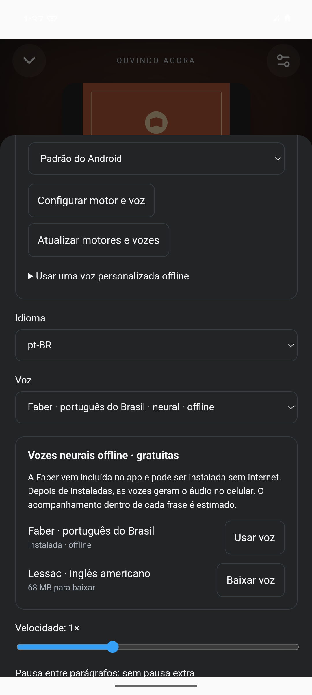

# Verificação da versão 1.0.1

Verificado em 2 de novembro de 2026:

- 22 testes web aprovados, incluindo busca, importação de EPUB e seleção da Faber pela ação **Instalar voz**.
- 11 testes nativos aprovados. O teste de instalação usa o arquivo real da Faber incluído no APK, confere seu SHA-256, descompacta o modelo e verifica a instalação sem fazer uma requisição de rede.
- Os testes de catálogo verificam a troca entre domínios reconhecidos, a preservação da busca e a rejeição de destinos arbitrários.
- A interface mostra progresso na instalação da voz. O catálogo oferece **Tentar de novo**, **Outro endereço** e **Navegador**, além de tentar alternativas em falhas de conexão.
- A Faber foi baixada da distribuição oficial do Sherpa ONNX: 67.183.065 bytes, SHA-256 `7add3f923ad6bc25ca8a192805fd1a64d1b3893e4611c4a9719545a825039a83`.

Também foi instalado o APK de produção em um emulador **Android 15 (API 35)**. Com **Wi-Fi e dados móveis desativados**, a Faber foi instalada pelo botão **Instalar voz**, o progresso foi exibido e a interface passou a mostrar **Instalada · offline**, com a Faber selecionada. Não houve teste em telefone físico.

As verificações de interface no navegador simulam o transporte nativo e executam os componentes reais do app. O teste nativo de instalação usa o pacote real da voz. A disponibilidade do site de livros continua dependendo da conexão e do próprio servidor.

## Histórico da versão 1.0.0

Verificado em 2 de novembro de 2026:

- 22 testes web aprovados: biblioteca, importação e validação de EPUB, narração, navegação, estatísticas e fluxo gratuito do catálogo.
- 5 testes nativos aprovados: filtro de links gratuitos, desafios de verificação do site, restrições de URL e remoção dos métodos de IA, premium e Entrelinhas.
- Build Android de produção concluído e assinatura APK v2 verificada.
- Pacote `org.folio.livre`, versão `1.0.0`, Android 7 ou mais recente, ARM de 32 ou 64 bits.
- APK inspecionado para confirmar a ausência do endpoint de IA, da configuração de chave premium e dos arquivos do Entrelinhas.

O teste do fluxo de download usa respostas controladas para o transporte nativo e um EPUB real. A importação, a validação, a persistência e a leitura executam o código do app. Os links gratuitos e as verificações do Anna’s Archive podem mudar. Esta versão não foi testada em um telefone físico nesta sessão.

O repositório começa com histórico novo. A revisão dos arquivos preparados para o commit usa `python3 scripts/check-public-source.py`; material de assinatura, configurações locais, bibliotecas pessoais e arquivos de ambiente ficam fora do Git.
