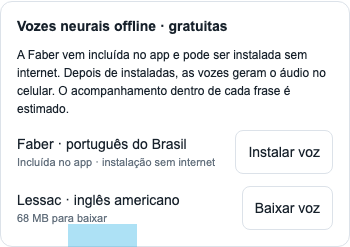

# Ouvir livros e instalar vozes

## Começar a ouvir

1. Abra um EPUB na biblioteca.
2. Toque no **alto-falante** ao lado do nome do capítulo. O botão se chama **Ler capítulo em voz alta**. Em tela cheia, toque no centro da página para mostrar os controles e depois no alto-falante.
3. No player, toque em **Voz e idioma** para escolher a voz. Feche as opções pelo **X**.
4. Toque em **▶ Ouvir**. Use **Pausar** para interromper e **Capítulo** para trocar de capítulo. As setas com **30** avançam ou voltam cerca de 30 segundos.

Para ouvir um trecho, selecione o texto no livro e toque no alto-falante **Ouvir seleção**. Em **Voz e idioma → O que ouvir**, confira se está selecionado **Trecho selecionado**.

## Instalar as vozes neurais gratuitas

As duas opções abaixo já estão integradas ao Folio Livre. Você não precisa criar conta, instalar outro aplicativo ou configurar uma chave.

| Voz | Idioma | Download |
| --- | --- | --- |
| **Faber · português do Brasil** | Português brasileiro | Incluída no APK 1.0.1; instala sem internet |
| **Lessac · inglês americano** | Inglês americano | Cerca de 68 MB |

Para ouvir livros em português, comece pela Faber. A preferência por uma voz é pessoal; experimente um parágrafo antes de ajustar a velocidade.

1. Abra um livro e entre no player pelo alto-falante.
2. Toque em **Voz e idioma** e role a janela até **Vozes neurais offline · gratuitas**.
3. Na **Faber**, toque em **Instalar voz**. O pacote já vem no app; esta etapa não usa a internet. Na **Lessac**, toque em **Baixar voz** para baixar cerca de 68 MB.
4. Aguarde a barra **Instalando e verificando** ou **Baixando e verificando** terminar. Deixe o Folio aberto durante a instalação.
5. Ao terminar, o app seleciona a voz e o idioma. Se a voz já estava instalada, toque em **Usar voz**.
6. Feche as opções pelo **X** e toque em **▶ Ouvir**.

A instalação exige pelo menos **300 MB livres** no celular para baixar e descompactar o arquivo. Esse é o espaço exigido durante a instalação. A Faber já vem no APK; para baixar a Lessac, Wi-Fi ajuda a poupar dados móveis.

Depois de instalada, a voz funciona **offline**, com o áudio gerado no aparelho. Para confirmar, ative o modo avião e ouça um parágrafo de um livro já importado.

## Ajustar a leitura

Em **Voz e idioma**:

- Comece com **Velocidade: 1×**. O controle permite de **0,5× a 2×**.
- Ajuste **Pausa entre parágrafos** e **Pausa após títulos**. Para acrescentar pausa somente nos títulos, deixe a pausa entre parágrafos em zero.
- Ative **Continuar no próximo capítulo** para ouvir os capítulos em sequência.
- Ative **Virar páginas junto com o áudio** se quiser acompanhar o texto. A posição dentro de cada frase é estimada nas vozes neurais.
- Use **Temporizador** para parar depois de 5, 15, 30 ou 60 minutos.

## Usar as vozes do Android

Você também pode escolher as vozes de um motor já instalado no celular:

1. Abra **Voz e idioma → Motor de voz** e escolha o motor desejado.
2. Toque em **Configurar motor e voz**. O Android abre as configurações desse motor; procure a opção de instalar dados de voz e escolha o idioma. Os nomes das telas variam conforme o aparelho e o motor.
3. Volte ao Folio e toque em **Atualizar motores e vozes**.
4. Escolha **Idioma** e **Voz**. A lista informa se a voz é **online** ou **offline**.

O campo **Padrão do aparelho** usa a configuração do motor do Android. Para escolher a Faber ou a Lessac, use **Usar voz** na seção de vozes neurais do Folio.

## Se não funcionar

- **A seção de vozes neurais não aparece:** abra o APK Android do Folio Livre. A prévia no navegador não instala essas vozes.
- **Faltou espaço:** libere pelo menos 300 MB no armazenamento interno e tente novamente.
- **A Faber ainda mostra Baixar voz:** atualize para a versão 1.0.1 pelo link da página inicial do projeto. Nela, a Faber vem no APK e o botão é **Instalar voz**.
- **O download da Lessac falhou:** confira a conexão, mantenha o app aberto e tente novamente. Anote a mensagem que aparece abaixo da barra se a falha se repetir.
- **A voz instalada não está selecionada:** entre em **Voz e idioma** e toque em **Usar voz** ao lado da voz.
- **O livro está em inglês e a voz soa estranha:** selecione Lessac. Para português, selecione Faber.
- **Não sai som:** confira o volume de mídia, a saída Bluetooth e se o player está em **Ouvir**. Teste também outro capítulo ou o livro de demonstração.

[Voltar às instruções de instalação](../README.md#baixar-e-instalar)
